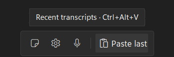
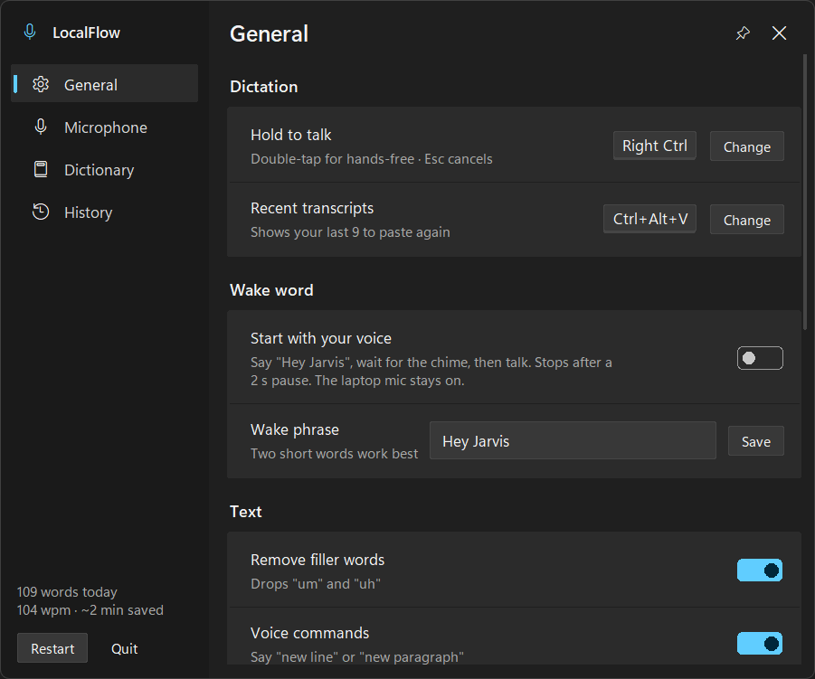
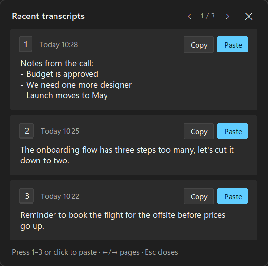
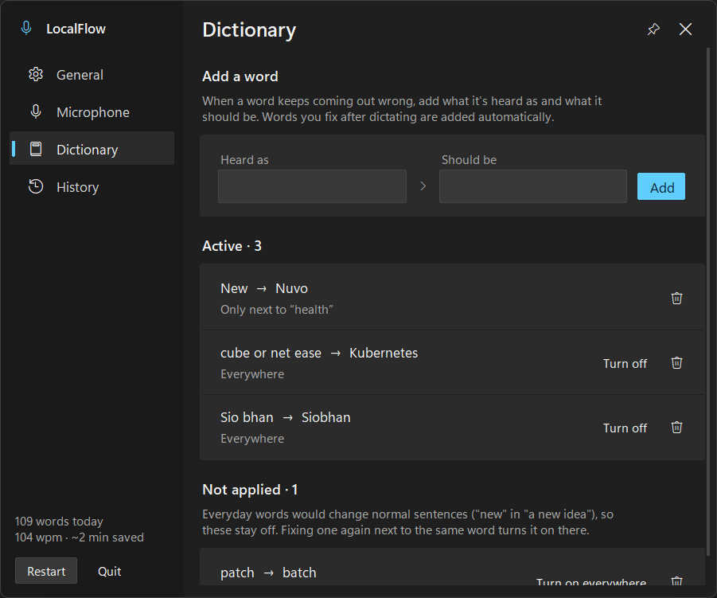
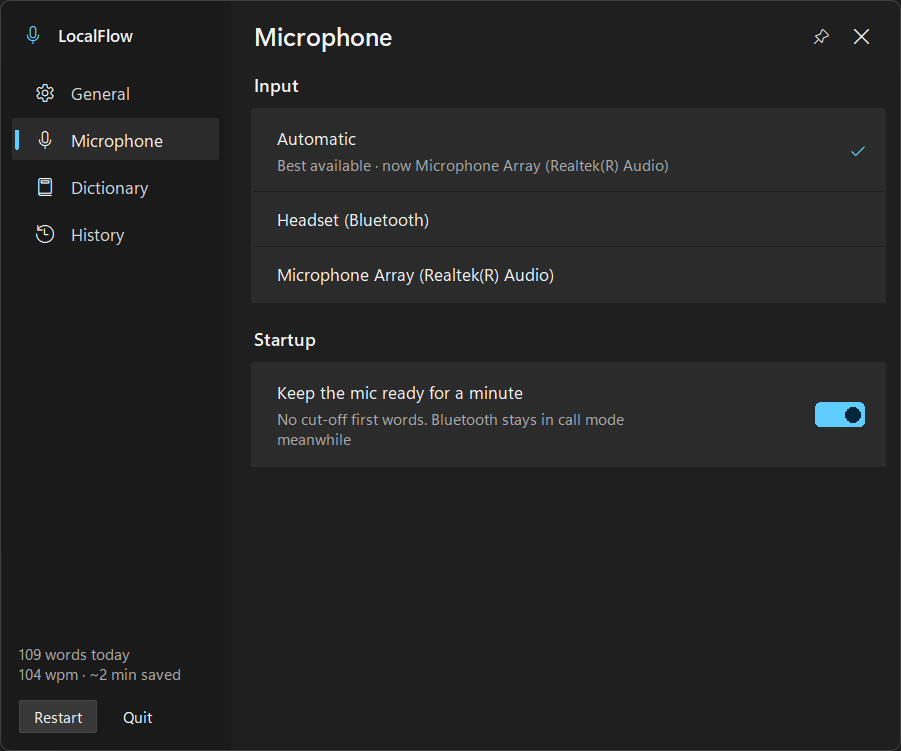
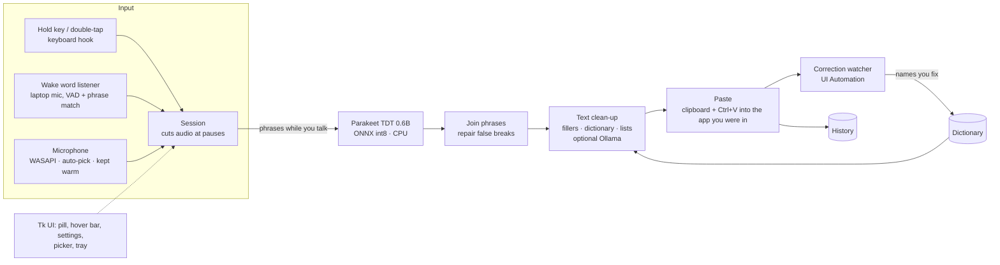

# LocalFlow

**Wispr Flow-style dictation that runs entirely on a 2019 budget laptop. Free, offline, Windows.**

Hold a key, talk, let go: your words appear wherever the cursor is, punctuated and
cleaned up. No account, no cloud, no word limits.

<p align="center">
  <br>
  
</p>

| | |
|---|---|
| **Text on screen after you stop talking** | 0.2 s in benchmarks · **1.2 s median** over 171 real dictations |
| **Cost** | $0 (Wispr Flow Pro: $12–15 per month) |
| **Runs on** | Ryzen 5 3550H CPU, no GPU needed, ~800 MB RAM |
| **Leaves the laptop** | Nothing |

---

## Why I built this

I dictate a lot: emails, prompts for AI tools, notes. Wispr Flow showed me how good
dictation can feel, but it sends audio to the cloud, and the free tier stops at 2,000
words a week. I wanted the same experience **privately, for free, and on the laptop I
actually own**: an HP Pavilion Gaming 15 from 2019.

Copying the product wasn't an option. Wispr Flow is closed source and its speech
recognition runs on its servers, so there's nothing local to take. Running the
big open models it's compared with wasn't realistic either: this machine has a 3 GB GPU
and a 4-core CPU. So the product question became:

> **What's the best dictation experience I can get from hardware that "shouldn't" run it,
> and which parts of a polished commercial product matter most when you can't have all of them?**

### The machine

| | |
|---|---|
| Laptop | HP Pavilion Gaming 15-ec0xxx (2019) |
| CPU | AMD Ryzen 5 3550H, 4 cores / 8 threads, 2.1 GHz |
| GPU | NVIDIA GeForce GTX 1050, **3 GB** (plus Radeon Vega 8 integrated) |
| RAM | 30 GB (upgraded) |
| Storage | 500 GB NVMe SSD + 1 TB HDD |
| OS | Windows 11 Home |
| Mics | Built-in Realtek mic array; Bluetooth earbuds |

## Who it's for

- **Me first:** a heavy dictation user on modest hardware who won't pay a subscription
  or send voice to a server.
- **Anyone with a similar laptop:** fork it and it works on mid-range Windows machines
  without an NVIDIA GPU.

**Non-goals (for now):** Mac/Linux/mobile, 100+ languages, team features, meeting notes,
cloud sync.

## What it does

| Feature | How it works |
|---|---|
| **Hold to talk** | Hold Right Ctrl, speak, release. Pasted into any app |
| **Hands-free** | Double-tap Right Ctrl; tap again to finish |
| **Wake word** (opt-in) | Say "Hey Jarvis", wait for the chime, talk; a pause ends it |
| **Clean text** | Punctuation and casing from the model; "um"/"uh" removed; pauses don't break sentences |
| **Spoken lists** | "One… two… three…" or "next point…" becomes a numbered or bulleted list |
| **Self-learning dictionary** | Fix a misheard name once and it's spelled right from then on, without breaking everyday words |
| **Recent transcripts** | Ctrl+Alt+V: your last 9 dictations, Win+V style, click to paste again |
| **Smart microphone** | Picks the best mic automatically, survives Bluetooth hiccups, switches when a headset connects |
| **Scratchpad and history** | A notepad that saves as you type; history with fix/copy/paste |

<p align="center">
  
  
</p>
<p align="center">
  
  
</p>

## Results

**Latency** (time from releasing the key to text on screen):

| | Short (7 s) | Long (21 s) |
|---|---|---|
| First version: Whisper small on the GPU | 1.3 s | ~1.5 s |
| Whisper small, tuned | 0.58 s | 0.15 s |
| **Parakeet on the CPU + transcribe-while-you-talk (shipped)** | **0.15 s** | **0.25 s** |

Benchmarks use clean recorded speech on an idle machine. Daily use is the honest number:

| Real dictations (171, 90 minutes of speech) | Median | 90th percentile |
|---|---|---|
| Under 10 s | 0.7 s | 1.6 s |
| 10–30 s | 1.3 s | 3.4 s |
| Over 30 s | 1.7 s | 4.2 s |

The gap is the CPU being shared with a browser, an IDE and the rest of the day.

**Footprint:** ~800 MB RAM, ~4% of one CPU core when idle, a 650 MB speech model, $0.

## Key product decisions

Each of these was a trade-off; the "why" is what I'd defend in a review.

| Decision | Alternatives | Why |
|---|---|---|
| **Build my own instead of reverse-engineering Wispr Flow** | Decompile the app | Its speech runs in the cloud, so there's no local model to extract, and it would break its terms. Building gave a product I can own and open-source |
| **Parakeet TDT 0.6B (NVIDIA) on the CPU** as the default engine | Whisper small on the 3 GB GPU | Faster on this machine (0.15 s vs 0.58 s), better punctuation, and keeps the GPU free. Whisper stays available for other languages and spelling hints |
| **Transcribe while you talk**, cutting at pauses | Transcribe once at the end | One pass took 3.2 s for 16 s of speech and 17 s for a minute on this CPU. Chunking makes long dictations as fast as short ones; the cost was false sentence breaks, fixed with join-repair rules and a 0.7 s pause threshold |
| **Right Ctrl, not Fn** | Fn like Wispr Flow on Mac | On most Windows laptops Fn is handled by the keyboard itself and never reaches Windows |
| **Ctrl+Alt+V for recent transcripts** | Alt+Shift+V | Overlay apps on the machine swallowed Alt shortcuts. Found by testing, not assumption |
| **Keep the mic open for a minute after dictating** | Open it on every key press | Bluetooth earbuds take ~1 s to switch into headset mode and were cutting off first words. Cost: the Windows mic icon stays on and earbuds stay in call mode, so it's a setting |
| **Dictionary with guardrails** | Swap a corrected word everywhere | A real failure: learning "New → Neu" turned every "new" into "Neu". Now everyday words only swap next to the words they were learned with, and edits like "Thursday → Friday" aren't learned |
| **Wake word by matching the sound of short phrases** | A trained wake-word model (openWakeWord) | Works for any phrase immediately, no training. Listens on the laptop mic only, and nothing is stored while listening |
| **Rule-based lists** | Ask an LLM to format | Predictable, offline, about 1 ms. An LLM would add 1–3 s to every dictation |
| **Windows 11 Fluent look** | Two other explored directions | Picked from three rendered options. It should feel native, not like a web page |
| **Open-source code, private data** | Ship sample personal data | Personal recordings, history and dictionary never leave the machine |

## Architecture



- **One Python file** (`localflow/localflow.py`, ~3,200 lines): the core, the Tk UI and
  the Windows integration. Easy to fork and read; splitting it up is on the roadmap.
- **Audio:** `sounddevice` / PortAudio over WASAPI. All audio-system restarts run on one
  dedicated thread, because Windows audio objects belong to the thread that creates them.
- **Speech:** `onnx-asr` running NVIDIA Parakeet TDT 0.6B v2 (int8) on the CPU;
  `faster-whisper` (CTranslate2) as the GPU / multilingual option.
- **Windows glue:** a global keyboard hook (`keyboard`), UI Automation (`uiautomation`)
  to read back corrected text, `ctypes` for focus, window styles and DPI.
- **UI:** Tkinter drawn to a small set of design tokens ([design brief](localflow/design/design-brief.md),
  [tokens](localflow/design/tokens.css)).

## What I learned from real use

Most of the work came after "it works": using it all day and fixing what broke.

| Symptom | Root cause | Fix |
|---|---|---|
| Hover-bar buttons did nothing | The panel moved on-screen *after* asking for focus, so it stayed parked off-screen | Apply the move first |
| "Microphone not available" for every mic | Audio system restarted on a single-threaded UI thread; recordings started from another thread | Dedicated multithreaded audio thread |
| First words lost with Bluetooth | Earbuds take ~1 s to switch into headset mode | Keep the mic warm, plus a 0.3 s pre-roll |
| Retries failed after a Bluetooth stall | Closing a stuck stream blocked for 15 s | Abort instead of stop; time-limited opens; fall back to the laptop mic |
| Random capitals mid-sentence | Each chunk was treated as its own sentence | Longer pauses for cuts; join-repair rules |
| "a Neu project" | Dictionary swapped an everyday word everywhere | Context-only swaps for common words |
| A long dictation didn't paste into an Electron app | Clipboard restored before the busy app read it | Restore later, and only if unchanged |
| Bar vanished after the laptop slept | Windows stops compositing see-through windows after resume | Detect the wake-up gap, rebuild them |
| Mic stuck after waking | A mic start hung in the audio library and blocked all later ones | Detect the hang; restart once to recover |

## Roadmap

Personalisation is where a local tool can beat a cloud one, because it can learn from
data that would never be uploaded:

1. **Fine-tune on my own voice.** LocalFlow can keep each dictation's audio with its
   final, corrected text. With a few hours collected, a LoRA fine-tune of Whisper
   (free Colab GPU, about an hour) should cut mishearings of my accent and vocabulary.
2. **A dictionary that keeps learning.** Corrections already teach it names. Next is
   learning from what I re-type most, and showing which corrections paid off.
3. **History-based personalisation.** Use past dictations to bias spelling and
   formatting towards how I actually write.
4. **Command mode:** select text, say "make this shorter", with a local LLM.
5. **Per-app style:** casual in chat, formal in email, code-aware in the IDE.
6. **Snippets** ("my calendar link") and **backtracking** ("at 5, actually 6" → "at 6").
7. **Split the single file** into modules with a test suite.

## What it isn't (yet)

See the full **[comparison with Wispr Flow](docs/wispr-comparison.md)**. In short:
English-first (Parakeet is English-only; Whisper covers other languages more slowly),
Windows-only, no command mode or per-app styles yet, and accuracy is a little behind a
large cloud model on difficult audio.

## Run it

Windows 10/11 and Python 3.12:

```bat
git clone https://github.com/Adarsh1313/local-flow.git
cd local-flow\localflow
setup.bat
run.bat
```

The first start downloads the speech model (~650 MB, once). An NVIDIA GPU is
optional. Full instructions and every setting: **[user guide](docs/user-guide.md)**.

## Privacy

Audio is processed on your machine and never sent anywhere; the app makes no network
requests (the optional AI cleanup talks only to Ollama on `localhost`). History,
dictionary, notes and optional training recordings stay in the app's folder.

## Credits

- Built by Adarsh as product owner: problem, decisions, testing and daily use.
  Code written with [Claude Code](https://claude.com/claude-code) as pair programmer.
- Speech models: **NVIDIA Parakeet TDT 0.6B v2** (CC-BY-4.0) via
  [onnx-asr](https://github.com/istupakov/onnx-asr); **OpenAI Whisper** (MIT) via
  [faster-whisper](https://github.com/SYSTRAN/faster-whisper).
- Libraries: sounddevice/PortAudio, keyboard, pystray, Pillow, uiautomation, wordfreq.

LocalFlow is an independent project. It isn't affiliated with or endorsed by Wispr,
contains no Wispr code, and was designed from Wispr Flow's publicly described features.

Code licensed under the [MIT License](LICENSE).
